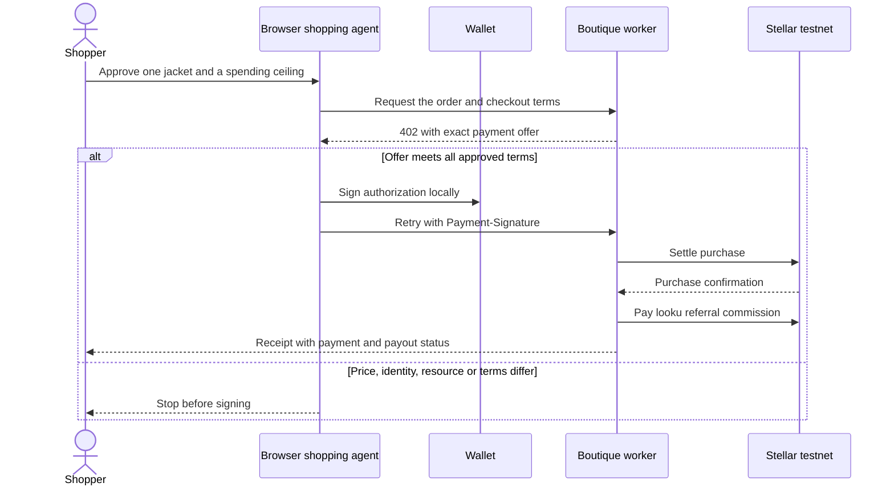

# looku at EmpowerHer

**Product question.** Can a shopper describe a look, reuse what they own, and let an agent buy one missing piece within a limit they control? The pilot tests this with one demo boutique, one cropped jacket and Stellar test XLM. It works with the seeded wardrobe on a first visit, or with the shopper’s own photos.

## A shopper’s journey

1. Add clothes on a phone or laptop. Describe an outfit, choose a palette and save the result. The local matcher works offline. Choosing online GPT would send the written brief for interpretation, subject to a configured API account. Neither matcher has a signing key.
2. If the outfit could use a layer, review the boutique’s jacket. Set a maximum in test XLM. With a 0.75 limit, looku recommends holding off. Wallet supports a named savings target against a public balance. The target does not lock funds.
3. With a sufficient limit, approve one purchase using an encrypted device wallet or Freighter. The browser agent obtains the boutique’s HTTP 402 challenge, selects an eligible offer, signs locally and retries the order with the x402 payment proof.
4. The boutique receives 1 test XLM. After purchase confirmation it pays 0.10 test XLM to looku. The receipt tracks both transfers independently. From Wallet, a shopper signed in with a restored device wallet can retrieve purchases indexed for that same address.

## Components and boundaries

| Component | Responsibility | Data and authority |
| --- | --- | --- |
| Installable PWA | Capture photos, style looks, manage palettes and display goals | Wardrobe in this browser’s IndexedDB. The installation cache holds app assets. Manual online backup encrypts a snapshot before upload. |
| Wallet account | Prove control of a Stellar testnet address | One-time challenge binds origin, network, address and expiry. Verified signature creates a 12-hour HTTP-only session. Looku stores the public address. The encrypted device key stays in its own local store. |
| Shopping agent | Decide whether a specific offer meets the shopper’s approval | Integer stroop comparison. Checks wallet, SKU, requested order URL, network, native asset, quoted amount, merchant, fee sponsorship and expiry before invoking the signer. One foreground purchase per approval. |
| Merchant and facilitator | Create an order, issue the challenge, validate proof and settle | Hosted worker stores order and transaction envelopes in R2. Conditional writes reserve a proof for one order and protect state changes from competing requests. Merchant and facilitator test keys are server secrets. |
| Receipt and commission service | Reconcile purchase first, then affiliate payout | The receipt can show a pending payout even after a successful purchase. Server-side wallet lookup derives the address from the verified session. No address supplied by a reader can select someone else’s index. |
| External stores and funding | Let shoppers explore Kenyan and international retailers and funding options | External merchant links follow each retailer’s own checkout. Commission tracking requires an approved publisher link. MiniSend’s verified hosted route uses Base USDC. The demo uses Stellar Friendbot and test XLM. |

## Payment sequence

The budget does not become a recurring allowance. The agent compares the quote to both the shopper’s limit and the displayed price, so raising the ceiling does not authorize a price increase. A buyer signature authorizes the Stellar transfer. A separate login signature only establishes an account session. See the [x402 HTTP 402 exchange](https://docs.x402.org/core-concepts/http-402).

## Working for the next user

Wallet identities and purchase indexes use the paying address. Two users on separate browser profiles get separate local wardrobes and wallets. A shared browser profile is one local wardrobe and currently supports one device wallet. Signing out of the online session leaves that wardrobe in the browser. Restoring a wallet recovers its identity, but wardrobe recovery requires the shopper’s separate optional backup, its passphrase and the original hosting sign-in. Legacy purchase receipts remain on their original device; refreshing a confirmed order indexes it for wallet lookup.

The implementation supports multiple wallet identities behind the studio’s existing private access setting. Before a public pilot, select the intended audience, try the complete journey with two independent users, and decide whether shared-device profile switching is needed.

## Demo Day walkthrough

Start with a new browser profile and a funded **testnet** wallet. Show a lilac-and-denim look with a missing jacket. Set the limit to 0.75 test XLM and choose **Check my limit**. Change it to 1.00, approve with the wallet and open the receipt. Show both Stellar explorer links, including any pending commission honestly. Restore the wallet in another profile, sign in and select **View wallet purchases**. Have the previously confirmed transaction links available in case the public test network is slow.

## Beyond the hackathon

| Stage | Next work | Release evidence |
| --- | --- | --- |
| Judge pilot | Publish or invite the intended judges, rehearse the full journey and record the demo. | A new judge can open the app, decline an over-budget purchase and find the confirmed receipt. |
| Multi-merchant pilot | Introduce approved product feeds, merchant identities, inventory and expiry. Record attribution and refund rules per merchant. | Two merchants supply real approved offers. A changed merchant or price requires new approval. |
| Reliable operations | Move reconciliation from request-driven refresh to a durable worker, monitor stuck payouts, add retention for expired sessions and test account deletion. | Duplicate delivery, interrupted execution and delayed confirmation each result in one purchase and the correct commission. |
| Real funds | Confirm provider contracts and Stellar funding support, review payment authorization and key recovery, and isolate mainnet configuration. | Independent security review, approved retailer relationships and a verified funding-to-refund flow precede real-money checkout. |
