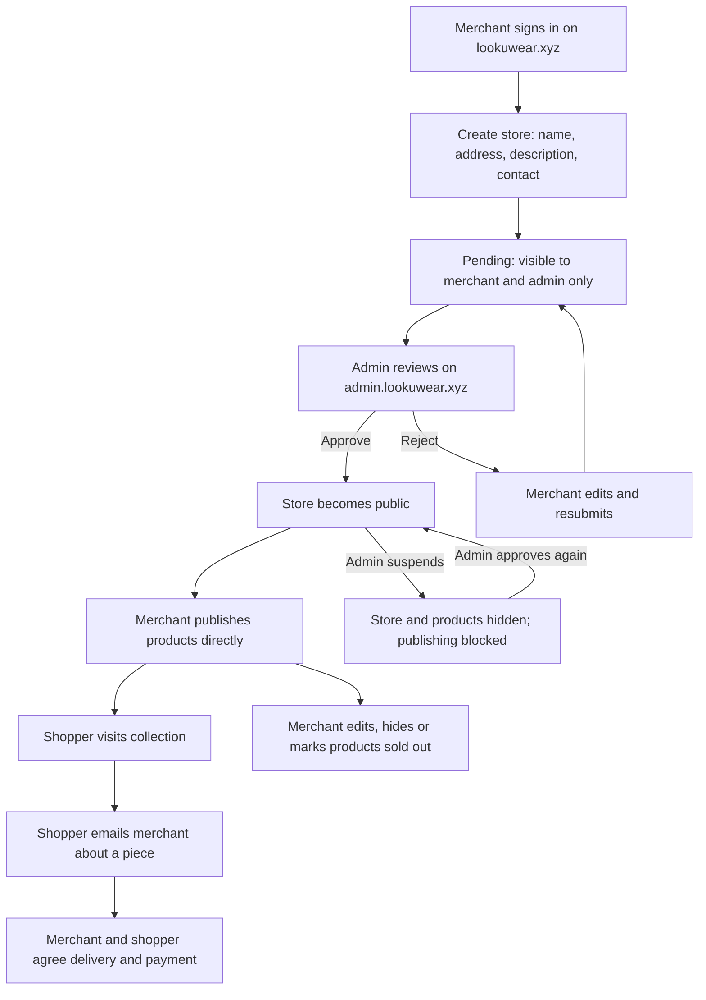

# Merchant stores

Merchants sign in on `lookuwear.xyz/app#merchant`, create a store, and submit it for Looku's approval. The store address is unique and cannot be changed after creation. The merchant's public contact email is shown to shoppers; their account identity stays private.

The public storefront is a dedicated merchant site: the merchant’s name in the header, collection navigation, product cards and direct store contact. Looku attribution and platform support stay in the footer. The Looku landing page and app navigation are not used on merchant domains.

## Sites and roles

| Site | Purpose |
| --- | --- |
| `lookuwear.xyz/app#shops` | Browse approved merchant stores and retailer links |
| `lookuwear.xyz/app#merchant` | Sign in, create stores, update store details and manage products |
| `lookuwear.xyz/store/{address}` | Public storefront; works without a dedicated merchant DNS record |
| `{address}.lookuwear.xyz` | Same public storefront after DNS/certificate activation |
| `admin.lookuwear.xyz` → Merchant stores | Approve, reject or suspend stores |
| `admin.lookuwear.xyz` → App features | Pause merchant storefronts across the platform |

Approved merchants publish products without item-by-item review. The separate community closet sale approval process is unchanged. Hidden and sold-out merchant products do not appear in public collections. Suspension hides the whole store immediately and prevents further merchant edits or publishing. Turning off Merchant storefronts hides public collections and stops new stores and product publishing, while merchants can still view their own records.

This release supports catalogues and email enquiries. It does not create checkout orders or collect merchant payments. Shoppers are told to confirm availability, delivery and payment with the merchant.

## Domain activation

`samaiahs.lookuwear.xyz` is attached to the Looku Vercel project and its CNAME has been verified. It displays a public collection once a merchant creates the `samaiahs` store and the admin approves it. No merchant account or store has been created on someone's behalf.

Other store addresses work immediately at `/store/{address}` after approval. Their subdomains need individual DNS activation, or a completed wildcard DNS/certificate setup. The wildcard is attached to Vercel, but the existing GoDaddy nameservers do not yet support Vercel's automatic wildcard certificate setup. Changing nameservers requires preserving the existing DNS records first.

## Verification

- `npm run build`: payment regressions and Vercel host-routing assertions.
- `node hosting/build.mjs && node qa/merchant-boundaries.mjs`: tenant isolation, private-data filtering, suspension and feature pause.
- `npm --prefix qa test -- merchant-stores.spec.js --workers=1`: desktop and phone creation, ownership, approval, publishing, edits, stale revision rejection and suspension.

Browser flow tests use an isolated in-memory bucket and temporary identities. They do not add test merchants or products to production.
